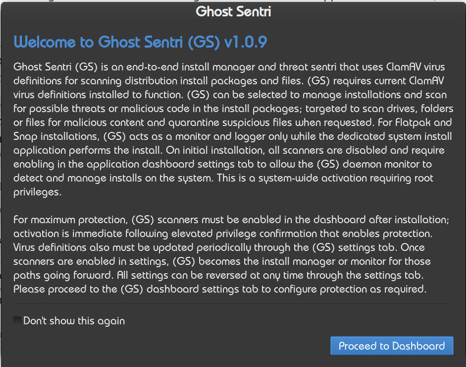
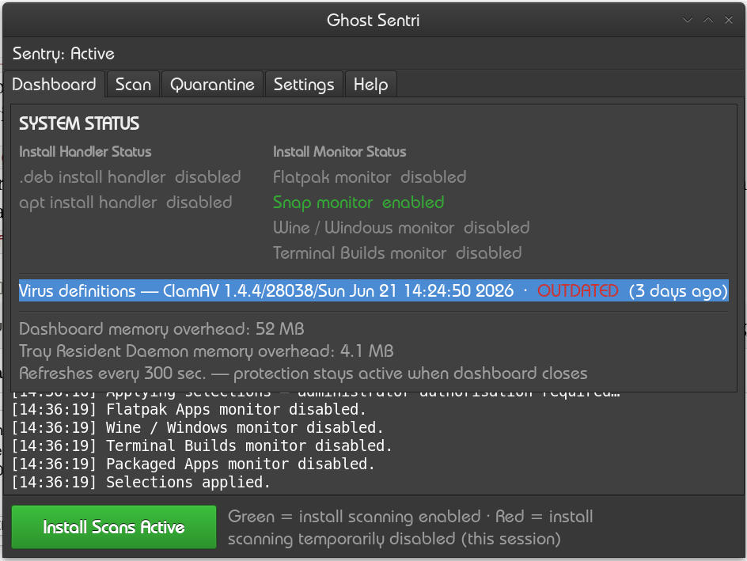
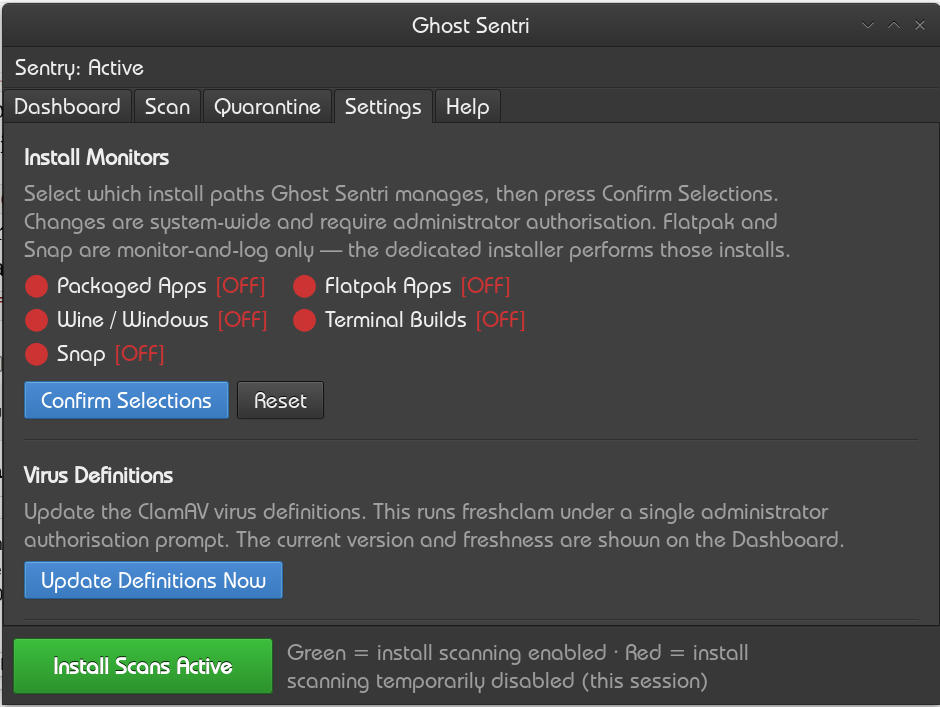

# Ghost Sentri (GS)

Security monitor and install interceptor for Linux Operating Systems using the Debian/apt/dpkg stack - debian version.
(GS) sits in front of package installs — it intercepts `.deb` installs
at the dpkg level (terminal apt and file-manager double-click), scans them with
ClamAV before they reach the system, and keeps a machine-wide audit trail of
what was installed.

## Developer

```
Developed for Lean Linux by:
Developer:  archerprojects
Maintainer: archerprojects <archer.projects@proton.me>
https://github.com/archerprojects/Ghost-Sentri
```

## Screenshots

| Welcome | Dashboard | Settings |
|---|---|---|
|  |  |  |

*First-run welcome, the read-only status Dashboard, and the monitor toggle grid in Settings.*

## Architecture

(GS) is a Cargo **workspace** of three crates, separated so the
always-resident process never links a GUI toolkit (the source of its former
memory footprint):

| Crate    | Binary                     | Role                                                              |
|----------|----------------------------|-------------------------------------------------------------------|
| `core`   | _(library)_                | Shared config, ClamAV scan, wire protocol, audit-event types. No GTK. |
| `daemon` | `ghost-sentri-daemon`      | Resident, **headless**. Tray, backends, sockets, audit, root `--apply`. `/usr/libexec`. |
| `daemon` | `ghost-sentri-installer`   | Privileged headless install **worker** (pkexec'd on demand).      |
| `daemon` | `ghost-sentri-dpkg-shim`   | Local `.deb` PATH-shim at `/usr/local/sbin/dpkg`; delegates to the apt-hook, fails open to the real dpkg. `/usr/libexec`. |
| `gui`    | `ghost-sentri`             | On-demand dashboard + installer UI. GTK4/libadwaita. `/usr/bin`.   |

At idle, only the headless daemon is resident — no GTK is mapped. The GUI is
launched on demand (tray, dashboard, or an intercepted install) and exits when
closed.

### Machine-policy model

Configuration is system-wide, root-owned policy at
`/etc/ghost-sentri/config.toml`. The install ships **inert** — no autostart, no
`.deb` handler, no apt hook — until a monitor is enabled. Enabling monitors is a
single root authorisation (`ghost-sentri-daemon --apply` via pkexec) that writes
the config, the apt hook, the `.deb` MIME default, and the autostart entry.

### Dashboard vs Settings

- **Dashboard** is a read-only situation report: which install handlers and
  monitors are active, the virus-definition version and freshness, memory
  overhead, and a live event log.
- **Settings** holds the controls: the monitor toggle grid (select, then Confirm
  Selections under one authorisation) and the definition-update button.

### Monitored install paths

- **Packaged Apps (apt / `.deb`)** — intercepted before dpkg executes; blocks
  until you approve or scan. Covers terminal `apt`, `nala` (repo **and** local
  `.deb`), `aptitude`, direct `dpkg -i`, and file-manager double-click. Local
  `.deb` installs that bypass the apt hook are caught by a `dpkg` PATH-shim
  resolved ahead of the real dpkg.
- **Terminal Builds** — source/script installs (`make install`, `curl | bash`).
- **Wine / Windows** — Windows executables landing in Wine prefixes.
- **Flatpak Apps** and **Snap** — **monitor and log only.** These package systems
  expose no pre-install gate a third party can hold, so (GS) detects and
  records their installs rather than blocking them; the dedicated installer
  performs the install.

## Prerequisites

- **ClamAV** — `clamav` and `clamav-base` ((GS) shells out to
  `clamscan`). Offered for install on first use if absent.
- **polkit** — for the authorisation prompts (`--apply`, definition updates,
  privileged install).
- A graphical desktop session (the daemon runs inside the user session so the
  polkit prompt can be shown).

Runtime dependencies are declared authoritatively in `debian/control`.

## Compatibility

Built and tested against Linux Mint 21–22 / Ubuntu 24.04 (GTK4 + libadwaita),
packaged as a native `.deb`. The interceptor backends are apt/dpkg-based today;
the privileged `--apply` path is structured by role so `dnf`/`pacman` support
can slot in later — multi-distro is on the roadmap, not in this build.

## Building

```bash
chmod +x build.sh && ./build.sh
```

Produces `dist/ghost-sentri_<version>_amd64.deb`. The version is
`MAJOR.MINOR` from `gui/Cargo.toml` plus a build-counter patch, stamped back into
`gui/Cargo.toml` so the About/welcome version always matches the `.deb`.

## License

GPL-3.0-only. See [`COPYING`](./COPYING).
